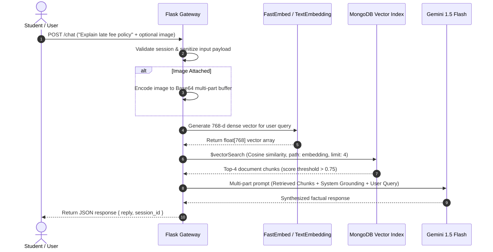
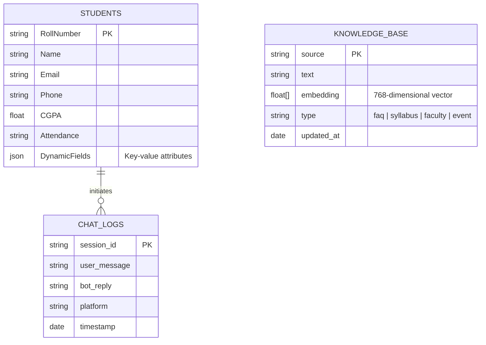

# ANITS AI Assistant

An omnichannel, RAG-powered campus intelligence platform that centralizes college data for accurate, context-grounded querying via Web, Telegram, and WhatsApp.

[](#live-demo)
[](https://www.python.org/)
[](https://react.dev/)
[](https://www.mongodb.com/)
[](LICENSE)

---

## Live Demo
- **Web Portal & AI Chatbot**: [anits.vercel.app](#)
- **Telegram Bot**: [@anil_2026_bot](https://t.me/anil_2026_bot)
- **Admin & Faculty Portal**: `/admin/login` (See [Setup](#setup) for local credentials)

---

## Screenshots
*(Attach 4–6 high-resolution screenshots of the Glassmorphism UI, floating chatbot widget, admin dashboard, and Telegram verification flow).*

---

## Problem
Educational institutions suffer from fragmented data silos. Students struggle to find current circulars, policies, and schedules scattered across outdated PHP portals and physical notice boards. Faculty spend excessive time answering repetitive administrative questions and manually managing disparate student databases. Existing generic chatbots fail because they hallucinate institutional policies, lack multimodal understanding (e.g., cannot parse timetable photos), and cannot verify student identities before disclosing sensitive academic records.

---

## Solution
The ANITS AI Assistant unifies unstructured college documents (PDF circulars, syllabuses, handbooks) and structured academic records (CSV/JSON) into a centralized MongoDB Vector Database. Built on a Retrieval-Augmented Generation (RAG) architecture powered by Google Gemini 1.5 and fast embedding models, it provides grounded conversational answers across Web, Telegram, and WhatsApp while enforcing strict role-based access control and cryptographic identity validation.

---

## Key Features
- **Omnichannel RAG AI**: Grounded conversational responses across Web, Telegram, and WhatsApp with semantic vector retrieval.
- **Multimodal Vision Pipeline**: Upload photos of printed notices or handwritten timetables for instant OCR and contextual synthesis.
- **Hinglish & Multilingual NLP**: Native support for regional languages (Telugu, Hindi) and romanized conversational queries.
- **Dynamic Schema Manager**: Automatically adapts database collections to dynamically uploaded CSV headers without manual migrations.
- **Fail-Secure Security**: Stateless JWT-authenticated portals, strict environment variable enforcement, and cryptographic phone verification via Telegram.
- **Faculty Broadcast Portal**: Asynchronous rich-text email broadcast system using Google SMTP with rate-limited chunking.

---

## Architecture

### System Topology
```mermaid
graph TD
    subgraph Client Layer
        Web[React 19 Web App]
        Telegram[Telegram Bot]
        WhatsApp[Twilio WhatsApp]
    end

    subgraph API Gateway & Orchestration (Flask)
        Router[API Router]
        Auth[JWT / Cryptographic Auth]
        RAG[RAG Orchestration Engine]
    end

    subgraph Data & AI Services
        Mongo[(MongoDB Atlas - BSON Store)]
        VectorDB[(MongoDB Atlas - HNSW Vector Index)]
        Gemini[Google Gemini 1.5 Flash]
        SMTP[Google SMTP Service]
    end

    Web -->|JSON / REST| Router
    Telegram -->|Long Polling / Webhook| Router
    WhatsApp -->|Webhook POST| Router

    Router --> Auth
    Auth --> RAG

    RAG -->|1. Vector Search Query| VectorDB
    VectorDB -->|2. Top-K Context Chunks| RAG
    RAG -->|3. Grounded Prompt + Payload| Gemini
    Gemini -->|4. Synthesized Answer| RAG
    
    Auth -->|Email Broadcasts| SMTP
    Auth -->|CRUD Operations| Mongo
```

### Data Retrieval (RAG) Sequence Flow


### High-Level & Low-Level Design
- **Stateless Gateway (`backend/app.py`)**: Central router utilizing decorators (`@token_required`) for JWT validation, with modular handlers for chat, authentication, CSV parsing, and external messaging webhooks.
- **Ingestion Worker (`backend/sync_vectors.py`)**: Automated script that loads structured fixtures (`data/*.json`) and circulars, computes dense embeddings using BAAI/bge-small-en-v1.5, and synchronizes them to MongoDB Atlas.
- **Frontend Client (`frontend/src/`)**: Built on React 19 and Vite with Tailwind CSS. Includes protected admin dashboards (`AdminDashboard.jsx`), faculty broadcasting tools, and an accessible floating chatbot interface (`Chatbot.jsx`).

---

## Database Design

### Logical ER Diagram


### Dynamic BSON Schema
Unlike rigid relational schemas, the `students` collection supports dynamic schema ingestion. When administrators upload new CSV records with changing academic headers (e.g., `Backlogs`, `Hostel_Block`, `Parent_Contact`), the backend dynamically upserts these attributes into BSON documents without requiring database migrations or schema alterations.

---

## API Specifications

### `POST /chat`
Core conversational and RAG inference route.
- **Headers**: `Content-Type: application/json`
- **Request Body**:
  ```json
  {
    "message": "What is the fee payment deadline for 3rd year?",
    "session_id": "web_session_98234",
    "image_base64": null
  }
  ```
- **Response (200 OK)**:
  ```json
  {
    "reply": "According to the Academic Calendar, the last date for 3rd year tuition fee payment without fine is November 15, 2026."
  }
  ```

### `POST /api/login`
Admin and faculty authentication endpoint.
- **Request Body**:
  ```json
  {
    "email": "admin@anits.edu.in",
    "password": "your_secure_password"
  }
  ```
- **Response (200 OK)**:
  ```json
  {
    "token": "eyJhbGciOiJIUzI1NiIsInR5cCI6IkpXVCJ9...",
    "expires_in": 86400
  }
  ```
- **Response (401 Unauthorized)**:
  ```json
  {
    "error": "Invalid email or credentials"
  }
  ```

### `POST /api/upload_student_data`
Dynamic CSV/Excel data ingestion for administrators.
- **Headers**: `Authorization: Bearer <JWT_TOKEN>`
- **Payload**: `multipart/form-data` with `file: students.csv`
- **Response (200 OK)**:
  ```json
  {
    "message": "Successfully upserted 1,250 student records with 8 dynamic fields."
  }
  ```

### `GET /api/admin/student_fields`
Retrieves all dynamic attribute keys discovered in the student collection.
- **Headers**: `Authorization: Bearer <JWT_TOKEN>`
- **Response (200 OK)**:
  ```json
  [
    "RollNumber",
    "Name",
    "Branch",
    "Phone",
    "CGPA",
    "Attendance",
    "FeeStatus"
  ]
  ```

---

## Machine Learning & Vector Ingestion Pipeline

The platform uses a reproducible, container-friendly vectorization pipeline:

1. **Document Extraction**: Scrapes text from unstructured documents and synthetic fixtures (`data/*.json`). Sanitizes whitespace, normalizes encoding, and strips non-printable characters.
2. **Contextual Chunking**: Breaks large documents into contextual spans with a configured chunk size of **1000 tokens** and **150 token overlap** to preserve semantic continuity across paragraph boundaries.
3. **Dense Vector Embeddings**: Employs `BAAI/bge-small-en-v1.5` (and Google `text-embedding-004`) to project textual semantics into a dense 768-dimensional vector space.
4. **Hierarchical Navigable Small World (HNSW) Indexing**: Vectors are upserted into MongoDB Atlas `knowledge_base` with an Atlas Vector Search index configured for Cosine Similarity.
5. **Prompt Synthesis & Hallucination Guardrails**: Queries retrieve the top 4 semantic chunks with similarity scores $\ge 0.75$. Gemini 1.5 Flash synthesizes the response with temperature set strictly to **0.2** and system prompts directing the model to acknowledge when information is not present in the college corpus.

---

## Tech Stack & Justifications

| Layer | Technology | Engineering Rationale |
|---|---|---|
| **Frontend** | React 19 + Vite | Vite provides instant HMR (< 200ms) and optimized production bundles. React 19 handles complex client-side state transitions across real-time student dashboards without full re-renders. |
| **Styling** | Tailwind CSS | Utility-first architecture enabling responsive glassmorphism UI layouts with zero CSS bundle bloat. |
| **Backend** | Python 3.11 + Flask | Python is the industry benchmark for AI/ML pipelines (LangChain, PyMuPDF, FastEmbed). Flask's lightweight WSGI design avoids framework overhead and permits low-latency request handling. |
| **Database** | MongoDB Atlas | Student attributes change across branches and academic years; NoSQL handles variable schemas natively. **Atlas Vector Search** eliminates the cost and network latency of running a separate vector store (e.g., Pinecone). |
| **LLM Inference** | Google Gemini 1.5 Flash | Offers high-throughput multimodal inference, processing text and Base64 image inputs concurrently with a 1M token context capacity. |
| **Embedding Engine** | FastEmbed (`bge-small-en-v1.5`) | Ultra-fast local embedding execution without external API round-trips for routine batch document indexing. |
| **Messaging** | Twilio & python-telegram-bot | Twilio manages official WhatsApp Business webhooks. Telegram's contact-sharing API facilitates hardware-verified identity validation for private student records. |

---

## Engineering Decisions

- **RAG over Fine-Tuning**: Campus policies, exam timetables, and circulars change weekly. Fine-tuning an LLM on campus data leads to stale weights and costly retraining. RAG decouples knowledge from weights, allowing instant document updates via vector upserts.
- **Fail-Secure Architecture**: Strict startup validation prevents the application from launching with fallback or default credentials. If `JWT_SECRET`, `ADMIN_PASSWORD`, or `ALLOWED_ADMIN_EMAILS` are missing or misconfigured, the service raises a `RuntimeError` immediately rather than defaulting to unsafe states.
- **Dynamic BSON Ingestion over Rigid SQL Tables**: College administrative departments format spreadsheets inconsistently. The backend dynamically infers CSV headers and updates BSON records directly, eliminating schema alteration downtime.
- **Cryptographic Telegram Identity Verification**: When students query private data (e.g., grades or attendance) via Telegram, the bot prompts for Telegram's native contact verification to confirm the phone number matches the registered database record, preventing identity spoofing.

---

## Folder Structure

```text
anits-college-website/
│
├── backend/
│   ├── app.py                 # Core API Gateway, JWT auth, RAG router, webhooks
│   ├── sync_vectors.py        # Vector ingestion and embedding pipeline
│   ├── requirements.txt       # Production dependencies (Flask, PyMongo, fastembed)
│   └── venv/                  # Local virtual environment (gitignored)
│
├── frontend/
│   ├── src/
│   │   ├── components/        # Chatbot.jsx, Navbar.jsx, Footer.jsx
│   │   ├── pages/             # AdminDashboard.jsx, FacultyDashboard.jsx, Home.jsx
│   │   ├── App.jsx            # Router and auth context wrapper
│   │   └── main.jsx           # React root entry point
│   ├── public/
│   │   └── robots.txt         # Crawler exclusions for admin & API endpoints
│   ├── tailwind.config.js     # Tailwind styling configuration
│   └── vite.config.js         # Vite build configuration
│
├── data/                      # Structured JSON fixtures & synthetic demo datasets
│   ├── demo_students.json     # Synthetic test records for reproducible onboarding
│   ├── faqs.json              # Institutional FAQ records
│   ├── faculty.json           # Faculty directory data
│   ├── events.json            # Campus events schedule
│   ├── placements.json        # Historical placement statistics
│   └── syllabus.json          # Departmental curriculum data
│
├── docs/                      # Architectural design and deployment deep-dives
│   ├── 01_Project_Overview.md
│   ├── 02_System_Architecture.md
│   ├── 03_API_and_Data.md
│   ├── 04_ML_and_Tech_Stack.md
│   └── 05_Deployment_and_Ops.md
│
└── README.md                  # Master System Documentation
```

---

## Setup & Local Development

### Prerequisites
- Python 3.11+
- Node.js 18+ and npm
- MongoDB Atlas cluster (or local MongoDB 6.0+)
- Google Gemini API key

### 1. Clone the Repository
```bash
git clone https://github.com/sandeep-kumar-270904/ANITS-Campus-AI-Assistant.git
cd ANITS-Campus-AI-Assistant
```

### 2. Configure Backend
```bash
cd backend

# Create and activate virtual environment
python -m venv venv
# On Windows:
venv\Scripts\activate
# On Linux/macOS:
source venv/bin/activate

# Install dependencies
pip install -r requirements.txt
```

### 3. Initialize & Sync Vector Database
Ensure your `.env` is populated (see [Environment Variables](#environment-variables)), then run the reproducible ingestion script:
```bash
python sync_vectors.py
```
*This parses all structured fixtures in `data/` and builds the vector search index.*

### 4. Start Backend Server
```bash
python app.py
# Server starts on http://localhost:5000
```

### 5. Configure & Start Frontend
In a new terminal:
```bash
cd frontend

# Install Node dependencies
npm install

# Start development server
npm run dev
# Frontend runs on http://localhost:5173
```

---

## Environment Variables

Create a `.env` file in the `backend/` directory. **Never commit this file to version control.**

```env
# Database Configuration
MONGO_URI=mongodb+srv://<username>:<password>@cluster0.mongodb.net/college_data?retryWrites=true&w=majority

# Security & CORS
FRONTEND_URL=http://localhost:5173
JWT_SECRET=your_generated_openssl_32_byte_secret_key
ADMIN_PASSWORD=your_secure_admin_password
ALLOWED_ADMIN_EMAILS=admin1@anits.edu.in,principal@anits.edu.in

# AI & LLM Inference
GEMINI_API_KEY=your_google_ai_studio_api_key

# Telegram Bot Integration
TELEGRAM_BOT_TOKEN=your_telegram_botfather_token

# Email Broadcasting (Google SMTP)
GMAIL_ADDRESS=college_notifications@anits.edu.in
GMAIL_APP_PASSWORD=your_16_character_google_app_password

# Twilio WhatsApp (Optional)
TWILIO_ACCOUNT_SID=your_twilio_sid
TWILIO_AUTH_TOKEN=your_twilio_token
```

---

## Testing Strategy

### Unit Tests
Execute unit test suites covering route validations, CSV header normalization, and prompt chunking:
```bash
cd backend
pytest tests/ -v
```

### API Integration Testing
Validate API routing and RAG context retrieval using automated test scripts or Postman:
```bash
# Test health and chat endpoint
curl -X POST http://localhost:5000/chat \
  -H "Content-Type: application/json" \
  -d '{"message": "Who is the HOD of CSE?", "session_id": "test_session"}'
```

### Frontend UI Testing
Run component-level regression tests for stateful components (modal alerts, login forms, chat bubbles):
```bash
cd frontend
npm test
```

---

## Deployment

### Frontend Deployment (Vercel)
1. Link your GitHub repository to [Vercel](https://vercel.com).
2. Configure project settings:
   - **Framework Preset**: Vite
   - **Root Directory**: `frontend`
   - **Build Command**: `npm run build`
   - **Output Directory**: `dist`
3. Add Environment Variable:
   - `VITE_API_URL`: `https://your-backend-api.onrender.com`
4. Deploy.

### Backend Deployment (Render / AWS Elastic Beanstalk)
1. Create a new **Web Service** on Render (or AWS Elastic Beanstalk) connected to your repository.
2. Configure runtime parameters:
   - **Root Directory**: `backend`
   - **Environment**: Python 3.11
   - **Build Command**: `pip install -r requirements.txt`
   - **Start Command**: 
     ```bash
     gunicorn app:app --worker-class eventlet -w 4 --bind 0.0.0.0:$PORT
     ```
     *(The 4 eventlet worker threads prevent non-blocking I/O stalls during concurrent Gemini LLM API calls).*
3. Add all production environment variables from `.env`. Ensure `FRONTEND_URL` is set to your deployed Vercel domain (e.g., `https://anits.vercel.app`).

### Docker Setup
To run the full stack containerized:
```bash
docker-compose up --build -d
```
*(Runs isolated containers for the Flask WSGI service and Vite static Nginx webserver).*

---

## Security Architecture

- **Fail-Secure Secret Management**: The application strictly refuses to boot if mandatory secrets are missing. No fallback strings or default passwords exist in code.
- **Origin Restriction (CORS)**: All API endpoints explicitly restrict cross-origin requests to the configured `FRONTEND_URL`, preventing malicious third-party cross-origin exploitation.
- **Stateless JWT Authorization**: Sensitive administrative endpoints require a Bearer token signed via `HS256` with a strict 24-hour expiration window.
- **Cryptographic PII Protection**: Student PII is never transmitted to unauthenticated channels. Telegram flows verify cryptographic identity proofs before reading academic databases.
- **Public Repository Hygiene**: Real student data is excluded. The repository uses synthetic fixtures (`data/demo_students.json`) to guarantee compliance with privacy and data protection standards.
- **Scraper Exclusions**: `frontend/public/robots.txt` explicitly disallows automated web crawlers from indexing administrative, login, and internal API routes.

---

## Troubleshooting Guide & FAQ

### Common Issues

1. **`RuntimeError: JWT_SECRET is required`**
   - *Cause*: Missing environment variable.
   - *Fix*: Create a `backend/.env` file with a valid `JWT_SECRET` string.
2. **CORS Blocked on Frontend Queries**
   - *Cause*: Origin mismatch.
   - *Fix*: Verify `FRONTEND_URL` in `backend/.env` exactly matches your frontend domain and port (without trailing slashes).
3. **MongoDB Atlas SRV DNS Resolution Failure**
   - *Cause*: Network DNS resolver cannot resolve `_mongodb._tcp` records.
   - *Fix*: Use standard Google DNS (`8.8.8.8`) or check network firewall settings for Atlas connection string.
4. **Gmail SMTP Authentication Errors**
   - *Cause*: Regular Google password used instead of App Password.
   - *Fix*: Enable 2FA on the Google account and generate a 16-character App Password under Security settings.

### Frequently Asked Questions

**Q: Can new columns be added to the student database without code changes?**  
**A:** Yes. The Dynamic Schema Manager inspects uploaded CSV headers and injects new fields directly into the BSON records, making them immediately accessible.

**Q: How do we update campus policies and circulars?**  
**A:** Place new documents or updated JSON files in `data/` and re-run `python backend/sync_vectors.py` to regenerate the vector index.

---

## Limitations & Future Work

### Current Limitations
- WhatsApp messaging is subject to Twilio developer sandbox constraints; production usage requires a verified Meta WhatsApp Business Account (WABA).
- Heavily degraded or handwritten scanned documents may experience reduced OCR accuracy via standard PyMuPDF extraction.

### Future Roadmap
- **Redis Response Caching**: Implement an in-memory Redis cache for frequently asked queries (e.g., fee structure, bus timings) to deliver sub-50ms responses and minimize LLM token consumption.
- **End-to-End Automated Testing**: Implement Cypress test suites simulating comprehensive user flows across web and bot interfaces.
- **Low-Latency Streaming Voice**: Transition from HTTP polling to WebRTC native audio-to-audio streaming via Gemini Live APIs.

---

## My Role
As the Lead Architect and Full-Stack Developer, I independently engineered the end-to-end platform:
- Architected the RAG retrieval pipeline and vector search integration with MongoDB Atlas.
- Engineered the stateless Flask API gateway, fail-secure authentication, and dynamic CSV schema parser.
- Built the responsive React 19 frontend dashboards and interactive chat interfaces.
- Integrated multi-channel webhooks for Telegram bot workflows and Twilio WhatsApp messaging.
- Designed the production deployment architecture across Vercel and Render.